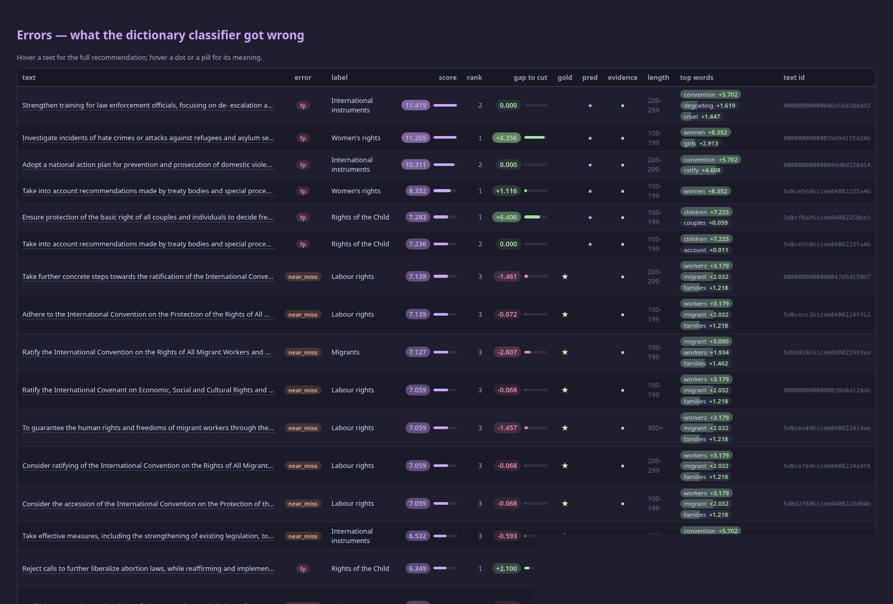
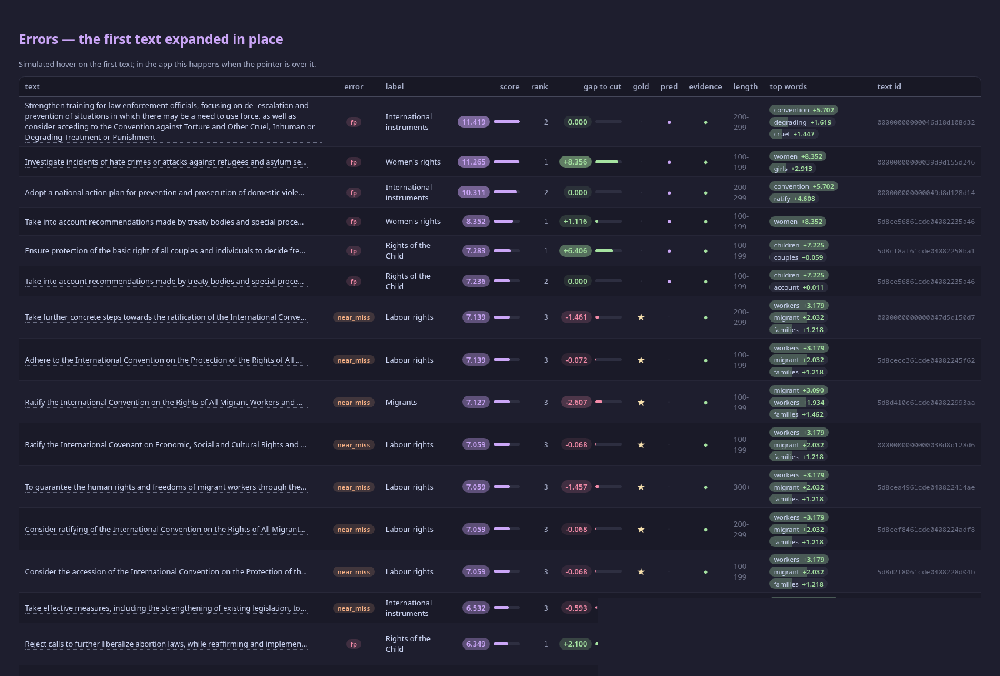
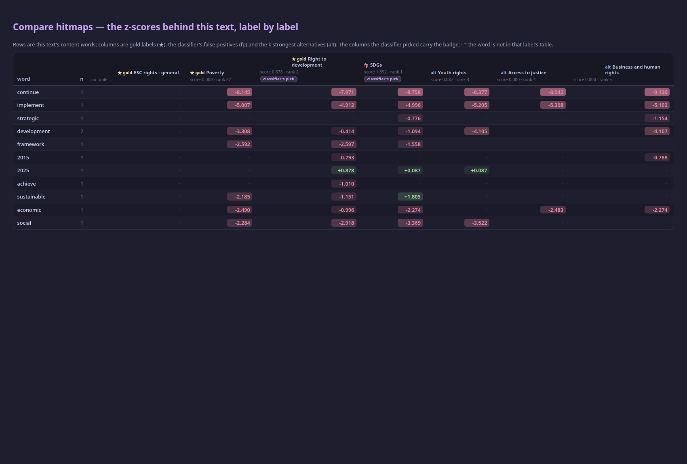

# Error viewer — V1 spec (data layer first)

Status: **pre-implementation spec**. V1 reads the existing artifacts; it runs no
experiment, writes nothing under `results/`, and changes no log or table. UPR
**val** only (660 texts, 68 labels, 1,312 gold cells); UPR `test` is untouched
and `omct-` runs are never read.

## Scope and staging

| stage | what | status |
|---|---|---|
| **V1** | the dictionary classifier's per-text predictions, recomputed from `results/upr-hitmap-corpus/hitmap.json`; three tables + five views; the guard | this spec |
| V2 | a `predictions` block for the pack and the LLM judge (a separate change set, proposed and stopped before implementing) | later |
| V3 | per-word causal what-if (2 LLM calls/word) | only if V1/V2 are accepted |

V1 is **discovery instrumentation**, not a demo. It must answer: what did the
classifier get wrong, on which label and text, with which words, and how close
was it to the cut. The app may be shown in a meeting, but research use comes
first.

Two facts fix the design (verified on the artifacts, 2026-11-05):

1. No analysis artifact stores which labels a text was predicted as.
   `results/upr-analyze-*/analysis.json` → `arms.<arm>.per_text.f1_counts` is
   660 rows of `[tp, fp, fn]` (the same block also holds per-text nDCG and the
   per-bucket counts, but no label identities). The pack and the LLM judge
   therefore support the **compare** view (counts) but not label-level error
   detail.
2. The dictionary classifier **is** reproducible: `map_score` over
   `corpus_map.per_label` plus the harness's `top_k` rule reproduces
   `report.overall.f1.micro_f1 = 0.5243161094224924` exactly (the reference
   `results/upr-eval-corpus-map-sum-zscore-positive-val/metrics.json`,
   reported as **0.5243**).

The classifier's own rule must be used, and it is **not** `dictionary_ranking`:
CS-47's ranking omits empty tables and zero-score labels, while the classifier
takes the stable top-k over all 68 columns after giving the eight empty tables
a floor (`min(seen) - 1`). The two agree above the zero tail and differ below
it. V1 reuses `map_score` (the exact per-word decomposition) and
`DictionaryRow` (the row shape), and keeps `dictionary_ranking` for the
evidence-bearing display where CS-47 defined it. A first recomputation shows
why this matters: **133 of the 1,320** predicted cells (112 texts' second slot
plus 21 texts' two slots) have score exactly 0 — they are tie-break fills, not
evidence. The viewer marks them `has_evidence = False`.

## Sources

| source | what V1 reads | provenance it checks |
|---|---|---|
| `configs/base.yaml` | `paths.data_raw`, `paths.data_splits`, `paths.results` | the file is printed |
| `data/raw/upr.jsonl` | texts, labels (read-only) | sha256 against the artifacts and split files |
| `data/splits/{train,val}_ids.json`, `label_holdout.json` | the split's records and the eight held-out labels | sha256, split name, counts |
| `results/upr-hitmap-corpus/hitmap.json` | `corpus_map.per_label` (rows: `word, n_with, df, lift, log_odds, z_score, word_class, is_name_word`), `corpus_map.corpus` | `source_sha256`; `corpus.split == "train"`; corpus texts == train ids; empty tables == `label_holdout.labels` |
| `results/upr-eval-corpus-map-sum-zscore-positive-val/metrics.json` | `report.overall.f1.micro_f1`, `n_predicted_cells`, `decision.k`, `split`, `n_records`, `n_labels`, `n_gold_cells` | `split == "val"`; `run_id` matches its folder; `decision.k == 2` |
| `results/upr-hitmap-surrogate/hitmap.json` | `ablation_map.arms.<arm>.surrogate.full_vector` (`vocabulary`, `topics`, `coefficients`); first arm by default | `split == "val"`; `topics` == the label space; each coefficient row's length == vocabulary length |
| `results/upr-analyze-*/analysis.json` | for compare only: `arms.<arm>.per_text.f1_counts`, `arms.<arm>.metrics.overall.f1.micro_f1`, `split`, `decision.k`, `dataset.n_texts` | `split == "val"`; 660 counts; counts summed reproduce the arm's own `micro_f1` at 1e-9; both sides share the same `k` |

The two compare series are `(run_id, arm)`. 146 exist on 2026-11-05 (e.g.
`upr-analyze-final-decision-feature` / `learned_histgb`, 0.5965). The dictionary
run is also offered as a series (its counts are recomputed; its labels exist).
A run without `per_text` (e.g. `upr-analyze-learned`) is **not offered**, and an
`omct-` run is never listed.

## The three tables

All rows carry `run_id` and `split`; all are deterministic from the sources
above. Sizes are the real val split.

### 1. `texts` — one row per text (660)

| field | type | derivation |
|---|---|---|
| `text_id` | str | `Record.id` |
| `text` | str | `Record.text` |
| `n_chars` | int | `len(text)` |
| `length_bucket` | str | the analyzer's edges `[100, 200, 300]` → `"0-99"`, `"100-199"`, `"200-299"`, `"300+"` |
| `gold_labels` | tuple[str, ...] | the record's own order |
| `predicted_labels` | tuple[str, ...] | top-k of the classifier (k from `decision.k`, 2) |
| `tp`, `fp`, `fn` | int | the per-text counts; `fn` includes near-misses |
| `n_gold`, `n_pred` | int | lengths |
| `text_f1` | float | `2tp / (2tp + fp + fn)`, 0.0 when the denominator is 0 |
| `rank1_score`, `rank2_score`, `rank3_score` | float | the classifier's scores at ranks 1–3 (floor included) |
| `margin` | float | `rank2_score − rank3_score` (the cut's margin) |
| `n_evidence` | int | labels with `score > 0` |
| `has_empty_slot` | bool | a predicted label with `score == 0` |

### 2. `cells` — one row per (text, label) (660 × 68 = 44,880)

| field | type | derivation |
|---|---|---|
| `text_id`, `label` | str | the key |
| `gold` | bool | the split's gold matrix |
| `predicted` | bool | `rank <= k` |
| `score` | float | `map_score(table(label), text_words)`; **0.0** for an empty table (the floor is a ranking device, never a score) |
| `rank` | int (1–68) | the classifier's rank: stable ties by the label space's order; empty tables last. It is **not** a re-sort of `score` (the floor and the ties would not reproduce it) |
| `error` | str | `tp` / `fp` / `fn` / `near_miss` / `ok` (below) |
| `has_table` | bool | the label's corpus table is non-empty |
| `has_evidence` | bool | `score > 0` |
| `gap_to_cut` | float | `score − score(rank k)`; ≥ 0 means at/above the cut |
| `run_id`, `split` | str | provenance |

### 3. `words` — one row per (text, label, word) that **gave the label points** (4,812 on val)

The exact decomposition of `map_score`: every (text, label, word) where the word
is one of the text's content tokens, is in the label's table, and its stored
`z_score > 0`. Negative-z pairs contribute 0 and are not rows (they can be added
later; they are not part of the score).

| field | type | derivation |
|---|---|---|
| `text_id`, `label`, `word` | str | the key |
| `z_score` | float | the artifact's stored `z_score` (positive) |
| `contribution` | float | `= z_score`; **sums to `cells.score`** for the (text, label) |
| `log_odds` | float | the artifact's stored `log_odds` |
| `n_with`, `df` | int | the artifact's counts |
| `word_class` | str | `distinctive` / `shared` / `generic` |
| `is_name_word` | bool | the artifact's flag |
| `surrogate_coefficient` | float \| None | `full_vector` at `(topic = label, word)`; `None` = "not in the decision model's vocabulary", **never zero** |
| `run_id`, `split` | str | provenance |

The surrogate is the **LLM judge's** fitted attribution (CS-24), not the pack's;
the app labels it "the model column" only as "the decision model's surrogate",
and never treats it as a prediction.

## Error taxonomy and the cut

The cut is the run's own `decision.k` (2). Ranks are the classifier's ranks
above; the near-miss window is `3 .. K` with **K = 5** by default (a module
constant with a CLI/app override; 10 is the other useful value, matching the
metrics' `ks`).

| `error` | rule | note |
|---|---|---|
| `tp` | gold and predicted | at rank 1–2 |
| `fp` | not gold and predicted | includes the zero-score tie-break fills (`has_evidence = False`) |
| `fn` | gold, not predicted, rank > K | a miss with no close call |
| `near_miss` | gold, not predicted, 3 ≤ rank ≤ K | the interesting case |
| `ok` | not gold, not predicted | — |

`near_miss` is **exclusive** of `fn` in the table. In the aggregates the miss
rate is reported as `(fn + near_miss) / n_gold`, and the two components are
shown separately. Per text, `tp + fp + fn` are the artifact-compatible counts
(near-miss counts as `fn`), so `texts` joins the analysis artifacts' view.

The per-text margin is the rank-2 minus rank-3 score; the per-cell
`gap_to_cut` is the distance to the cut. At K = 5 the real val split has **163**
near-misses (101 at rank 3, 41 at rank 4, 21 at rank 5); at K = 10, 188. These
are acceptance anchors, recomputed from the artifact, not artifact numbers.

## The guard

`python tools/error_view.py --check` runs all checks, prints a report naming
every source, and exits **0** only if all pass; on any failure it prints the
mismatch and exits **1**. The app runs the same function at load; on failure it
shows a red banner and blocks every view (`st.stop`) — the verified numbers are
never displayed next to stale ones.

1. **Reproduction.** Recompute the scores from `corpus_map.per_label` with
   `content_tokens` + `map_score`, apply the harness `top_k` rule (stable,
   empty-table floor), compute val micro-F1, and compare with the artifact's
   `report.overall.f1.micro_f1` at **1e-9**. Report both numbers with their
   sources: `0.5243161094224924` (artifact, `.../metrics.json`) vs the
   recomputation. This is the reference; a future run whose predictions V1 reads
   gets the same check against its own artifact.
2. **Map provenance.** `corpus_map.corpus.split == "train"`; the artifact's
   `source_sha256` == sha256(`data/raw/upr.jsonl`) == the split files'
   `source_sha256`; corpus `n_texts` == len(train ids); the label space == the
   68 sorted labels; the labels with empty tables == `label_holdout.labels`
   (exactly eight, by name).
3. **Evaluation artifact.** `split == "val"`, `run_id` matches the folder,
   `decision.k == 2`, `n_records == len(val ids)`, `n_labels == 68`,
   `n_gold_cells == 1312`, `n_predicted_cells == 1320`.
4. **Surrogate artifact** (when its column is shown). `split == "val"`,
   `topics` == the label space, and every coefficient row length == the
   vocabulary length.
5. **Compare series.** For each selected `(run, arm)`: `split == "val"`, 660
   counts, `dataset.n_texts == 660`, the two sides' `decision.k` equal, and the
   summed counts reproduce that arm's own `metrics.overall.f1.micro_f1` at
   1e-9. A failed series is refused, never silently greyed out.

## Views

1. **Errors.** Filter by label (gold and/or predicted), error type, length
   bucket, minimum confidence, `has_evidence`, and free text; sorted by how
   confident the mistake was (the predicted score for an FP / near-miss; the
   score at the cut for an FN). Each row: text, gold, predicted, counts, the
   label's rank/score, `gap_to_cut`, the top contributing words. Selecting a row
   opens **One text**.
2. **One text.** The ranked labels (top-N, every gold label with its true rank,
   near-misses); per-text tp/fp/fn and margin; a word × label matrix for the
   labels that matter (gold, predicted, top-5, the contrast B). Columns:
   **dictionary** (`contribution`, from `words`) and **model**
   (`surrogate_coefficient`, from `full_vector`), side by side, colour-coded by
   sign; a word with no stored coefficient reads "not in the decision model's
   vocabulary". B is `default_contrast_label` (the map's runner-up among the
   labels the text does not carry), as in CS-40. A zero-score prediction is
   marked **"empty slot (tie-break)"**.
3. **Aggregates.** (a) label confusion: the strongest `gold A → predicted B`
   pairs; (b) per-label TP / FP / FN / near-miss counts and rates, with support
   and bucket; (c) words driving FPs: the words with the most FP cells, each
   with its TP/FP split and mean z (the dictionary's own evidence); (d) coverage
   holes: labels never predicted, never predicted **with evidence**, and labels
   with no table; (e) per length bucket and per frequency bucket error rates.
4. **Compare runs.** Pick two `(run, arm)` series. Join `per_text.f1_counts` by
   row (= `val_ids` order, the analyzer's order; the app prints that mapping).
   Show per-text `Δf1`, `Δtp`/`Δfp`/`Δfn`, improved/worsened, and the margin's
   change. Label-level detail is shown **only** where predictions exist (the
   dictionary series, or V2's future predictions); for the pack/LLM the view
   says "labels not stored" and shows counts only. No label is inferred from a
   count.
5. **Export.** The current filtered rows as CSV/TSV (texts, cells, words, or a
   compare table) plus a provenance block: data sha, split sha, artifact paths
   and shas, run ids, k, K, seed, the guard result, and the note "UPR val; test
   untouched". Download only — nothing is written under `results/` or `docs/`.

## Data-layer API (`tools/error_view.py`)

Pure (numpy + stdlib; no model client, no streamlit, no network), deterministic
given the files; every derivation has an explicit input.

- dataclasses: `Sources`, `Provenance`, `GuardReport`, `TextRow`, `CellRow`,
  `WordRow`, `Tables`, `RunSeries`, `CompareRow`;
- loading: `load_sources(config, results, split, corpus_run, eval_run,
  surrogate_run)`, `load_context(...)`, `load_run_series(results)`;
- arithmetic: `map_scores(tables, records, labels)`, `decision_scores(...)`,
  `ranks(scores)`, `top_k(scores, k)`, `error_of(gold, predicted, rank, k, K)`,
  `text_f1(tp, fp, fn)`;
- tables: `build_tables(...) -> Tables`, and the aggregates
  (`label_confusion`, `label_rates`, `false_positive_words`, `coverage_holes`,
  `bucket_rates`, `compare_series`);
- guard: `check_all(...) -> GuardReport` (the five checks above);
- export: `to_csv(rows, fields)`, `provenance_block(...)`;
- `main(argv)` for `--check` (headless) and `--dump` (write a table to stdout).

`tools/error_app.py` is the only file that imports `streamlit` (and pandas for
display); it calls the data layer and renders the five views. Streamlit is
added to the **dev** group in `pyproject.toml` (and `uv.lock`); no new runtime
dependency enters `src/`.

## Acceptance checks

1. **Hand-computed unit tests** (`tests/test_error_view.py`, tiny synthetic map
   and artifacts, no network/model):
   - `map_score` + top-k reproduce a hand-computed micro-F1; a zero-score
     tie-break and the empty-table floor are pinned;
   - taxonomy boundaries: rank 2 = `tp`, rank 3 = `near_miss` (K=5), rank 6 =
     `fn`, non-gold rank 1/2 = `fp`, `ok`;
   - `sum(words.contribution) == cells.score` for every synthetic (text, label);
   - the surrogate join: present coefficient, and `None` (never 0) outside the
     vocabulary;
   - the guard: a tampered F1, split, sha, label space, empty-table set, or
     compare-run sum each produce a mismatch and exit 1;
   - compare: deltas on synthetic counts; a run without `per_text` and an
     `omct-` run are not offered;
   - aggregates and CSV export on a tiny table;
   - purity: an AST/read test asserts `tools/error_view.py` imports no
     `streamlit`, `torch`, `sentence_transformers`, `httpx` or `sqlite3`.
2. **Real-artifact checks** (`python tools/error_view.py --check`): exit 0;
   artifact `0.5243161094224924` vs recomputed at 1e-9; 660 texts, 44,880
   cells, 4,812 words; 1,312 gold cells, 1,320 predicted cells; 163 near-misses
   at K=5 / 188 at K=10; 8 empty tables == the held-out labels.
3. **App smoke test** (Streamlit `AppTest`, no browser, no network — skipped
   only if streamlit is absent): all five views render on the real val data;
   the guard banner is absent; the Errors view lists a known near-miss; the
   Compare view pairs `upr-analyze-final-champion / full_text` with
   `upr-analyze-final-decision-feature / learned_histgb` and reports
   Δ micro-F1 = +0.0486 (0.5479 → 0.5965) with no label detail for the pack.
4. **The gate**: `ruff check` and `ruff format --check` over `src`, `tests`,
   `tools`; the full `pytest` suite passes; `git status` shows only the
   intended files; nothing under `results/` changed.

## Not in V1

No pack/LLM predictions (V2), no per-word causal what-if (V3), no static HTML,
no new run, no artifact rewrite, no log or table edit, no change to the
pipeline. If a real discrepancy appears, it is reported, not fixed.

## V1 screenshot

The Errors view, rendered from the app's own HTML (UPR val, `k=2`). The text
cell truncates and **expands in place** when hovered (no tooltip); the error
badges, score/gap chips, boolean dots and contributing-word pills are
read-only. The table frame scrolls (72 vh) with its **header row pinned**; the
screenshot shows the whole table. The colour scheme is Catppuccin Mocha
(`.streamlit/config.toml` and `tools/error_app.css`).

Hovering a text expands it in place — the first row, expanded:

## Interactive mode (2026-11-05)

The sidebar's **interactive tables** toggle switches any table to Streamlit's
native dataframe, with the same rows, filters and order: click a header to
sort, and the table toolbar provides search, download and fullscreen. Off (the
default) is the styled read-only HTML view. The native hitmap shows a blank cell
for the map's silence; the styled view shows `·`.

## Compare hitmaps (V1.1, 2026-11-05)

A sixth view, between **Compare runs** and **Export**. Pick one text; the view
shows one row per content word (deduplicated, text order) and one column per
label:

- every **gold** label of the text (`★ gold`);
- every **false positive** the classifier predicted (`fp`);
- the **k strongest other labels** (`alt`, a control; `k=0` shows only gold and
  FPs). Empty tables are not offered as alternatives because they carry no
  evidence.

A cell is the corpus map's **stored z-score** for that (word, label) pair:
green pulls the label up, red pushes it down. `·` means the word is **not in
that label's table** — the map is silent, and the scorer contributes 0, so the
cell is never printed as a measured zero. The column header carries the label's
map score and classifier rank, or `no table` for the held-out labels. Columns
the classifier actually picked carry a **classifier's pick** badge next to their
rank. The shared table frame keeps the header pinned while the rows scroll.

